# Sistem Manajemen Perpustakaan Kampus
Program Java berbasis konsol untuk membantu petugas perpustakaan kampus mengurus kategori buku, koleksi, lokasi rak, antrean mahasiswa, peminjaman, sampai pembatalan transaksi. Semuanya jalan dalam satu program dengan menu interaktif, dan di dalamnya kami memakai enam struktur data yang diminta di tugas: Array 1D, 2D, 3D, ArrayList, Stack, dan Queue.

## Tugas Pemrograman Java
- **Mata Kuliah:** Pemrograman Berorientasi Objek
- **Dosen Pengampu:** M. Ibadurrahman Arrasyid Supriyanto M.Kom.
- **Program Studi:** Sistem Informasi
- **Angkatan:** 2025
- **Kelompok:** 24

## Anggota Kelompok 24
1. *Kardila Varani Barutu* - 2509116009 - Kelas A
2. *Zahra Maysita* - 2509116015 - Kelas A
3. *Mohammed Rifqy Syahdi* - 2509116037 - Kelas A
4. *Nabila Fitriani* - 2509116063 - Kelas B

## Struktur File Proyek
```text
PerpustakaanKampus-Java-Kelompok-24/
├── assets/                                  
│   ├── 01-kategori-buku.jpeg
│   ├── 02-tambah-buku.jpeg
│   ├── 03-tampilkan-buku.jpeg
│   ├── 04-hapus-buku.jpeg
│   ├── 05-lokasi-valid.jpeg
│   ├── 06-lokasi-invalid.jpeg
│   ├── 07-antrean-tambah.jpeg
│   ├── 08-antrean-panggil.jpeg
│   ├── 09-peminjaman-valid.jpeg
│   ├── 10-peminjaman-kategori-salah.jpeg
│   ├── 11-peminjaman-salah-3x.jpeg
│   ├── 12-undo-transaksi.jpeg
│   └── 13-keluar-program.jpeg
├── src/
│   └── com/mycompany/sistemperpustakaan/
│       └── SistemPerpustakaan.java          
├── .gitignore
└── README.md
```

## Studi Kasus dan Tujuan Program
Bayangkan petugas perpustakaan kampus di hari yang ramai. Mahasiswa antre di loket, buku baru datang dan harus dicatat, ada yang menanyakan di rak mana buku tertentu disimpan, dan di akhir pekan petugas ingin tahu kategori apa yang paling sering dipinjam. Kalau ada salah catat, transaksinya juga harus bisa dibatalkan.

Program ini kami buat untuk menjawab keadaan seperti itu. Tujuan kami ada dua. Yang pertama, menyediakan satu aplikasi konsol sederhana yang menunya gampang diikuti. Yang kedua, belajar memakai enam struktur data di tempat yang memang cocok untuknya, supaya kami paham kapan array dipakai dan kapan koleksi dinamis lebih pas.

## Penerapan Enam Struktur Data

### Array 1 Dimensi
Variabelnya `String[] kategoriBuku`, isinya empat kategori: Pemrograman, Matematika, Jaringan Komputer, dan Basis Data. Jumlah kategori kami anggap tetap, jadi array cocok. Indeks 0 sampai 3 dipakai lagi di menu peminjaman sebagai nomor kategori.

### Array 2 Dimensi
Variabelnya `int[][] statPinjam`, ukurannya 4 x 7. Barisnya mewakili kategori, kolomnya mewakili hari dari Senin (0) sampai Minggu (6). Jadi `statPinjam[2][4]` adalah jumlah peminjaman buku Jaringan Komputer di hari Jumat. Setiap peminjaman yang valid menambah satu pada sel yang sesuai.

### Array 3 Dimensi
Variabelnya `String[][][] lokasiBuku`, ukurannya 3 x 5 x 10. Kami membayangkannya sebagai gedung dengan 3 lantai, tiap lantai punya 5 rak, dan tiap rak punya 10 posisi buku. Isi selnya adalah judul buku yang disimpan di koordinat itu, dan sel yang kosong berarti belum ada buku di sana.

### ArrayList
Variabelnya `ArrayList<String> daftarBuku`. Jumlah buku di perpustakaan terus berubah, sehingga kami butuh wadah yang ukurannya bisa menyesuaikan sendiri. ArrayList mendukung tambah, tampil, dan hapus buku tanpa kami mengatur kapasitas.

### Stack
Variabelnya `Stack<String> riwayatTransaksi`. Tiap peminjaman yang berhasil dicatat dimasukkan ke tumpukan lewat `push()`, jadi transaksi paling baru selalu ada di puncak. Sifat LIFO ini yang kami manfaatkan saat membatalkan transaksi.

### Queue
Variabelnya `Queue<String> antrianMhs`, dengan `LinkedList` sebagai objek di belakangnya. Mahasiswa yang datang lebih dulu dipanggil lebih dulu (FIFO), seperti antrean di loket sungguhan.

## Penjelasan Source Code
Bagian ini menelusuri `SistemPerpustakaan.java` dari atas ke bawah. Penjelasannya kami tulis sendiri sesuai yang kami pahami dari kodenya.

### 1. Package dan import
```java
package com.mycompany.sistemperpustakaan;

import java.util.ArrayList;
import java.util.LinkedList;
import java.util.Queue;
import java.util.Scanner;
import java.util.Stack;
```
Baris `package` menunjukkan file ini ada di paket `com.mycompany.sistemperpustakaan`, dan letak foldernya di `src/` harus mengikuti nama itu. Lima baris `import` setelahnya memanggil kelas yang tidak otomatis tersedia di Java. `ArrayList` untuk daftar buku, `LinkedList` dan `Queue` untuk antrean, `Scanner` untuk membaca ketikan dari keyboard, dan `Stack` untuk riwayat transaksi.

### 2. Kelas utama dan variabel
```java
public class SistemPerpustakaan {
    public static void main(String[] args) {

        try (Scanner input = new Scanner(System.in)) {

            String[] kategoriBuku = {"Pemrograman", "Matematika", "Jaringan Komputer", "Basis Data"};
            int[][] statPinjam = new int[4][7]; // 4 kategori, 7 hari
            String[][][] lokasiBuku = new String[3][5][10]; // Lantai, Rak, Posisi

            ArrayList<String> daftarBuku = new ArrayList<>();
            Stack<String> riwayatTransaksi = new Stack<>();
            Queue<String> antrianMhs = new LinkedList<>();

            boolean lanjut = true;
```
`SistemPerpustakaan` adalah kelas utamanya, dan program mulai berjalan dari method `main`. Di dalamnya ada `try (Scanner input = ...)`. Dengan bentuk ini, `Scanner` ditutup otomatis saat blok `try` selesai, jadi kami tidak perlu menulis `close()` sendiri.

`kategoriBuku` langsung kami isi dengan empat teks. `statPinjam` dibuat 4 x 7 dan semua selnya otomatis 0. `lokasiBuku` dibuat 3 x 5 x 10 dan semua selnya awalnya `null`, artinya belum ada buku.

Tiga baris berikutnya membuat koleksi kosong untuk daftar buku, riwayat transaksi, dan antrean. Tulisan `<String>` memberi tahu Java bahwa isinya teks. Antrean dideklarasikan sebagai `Queue` tetapi dibuat dari `LinkedList`, karena `Queue` hanya aturan main dan butuh kelas nyata yang menjalankannya.

Variabel `lanjut` adalah penanda untuk perulangan utama. Selama masih `true`, menu akan terus tampil.

### 3. Perulangan menu utama
```java
            while (lanjut) {
                System.out.println("\n=== SISTEM MANAJEMEN PERPUSTAKAAN KAMPUS ===");
                System.out.println("1. Tampilkan Kategori Buku");
                ...
                System.out.println("7. Keluar");
                System.out.print("Pilih menu : ");

                int pilihan = input.nextInt();
                input.nextLine();

                switch (pilihan) {
```
`while (lanjut)` mengulang seluruh menu sampai `lanjut` diubah jadi `false`, yang terjadi di menu 7. `\n` di awal judul sengaja dipakai untuk memberi satu baris kosong supaya tampilan tidak menempel dengan keluaran sebelumnya. Di baris "Pilih menu" kami memakai `print` tanpa `ln` agar kursor tetap sebaris dengan pertanyaannya.

`input.nextInt()` membaca angka pilihan ke variabel `pilihan`. Satu hal yang sempat bikin kami bingung: `nextInt()` tidak ikut mengambil tombol Enter yang diketik. Kalau dibiarkan, `nextLine()` berikutnya akan langsung terlewati. Karena itu ada `input.nextLine()` yang hasilnya tidak disimpan, fungsinya cuma membuang sisa Enter.

`switch (pilihan)` lalu memilih blok yang dijalankan. Kami memakai bentuk `case 1 -> { ... }` dari Java modern, yang tidak butuh `break` supaya tidak "tembus" ke case berikutnya.

### 4. Case 1: tampilkan kategori (Array 1D)
```java
case 1 -> {
    System.out.println("\n-- Kategori Buku --");
    for (int i = 0; i < kategoriBuku.length; i++) {
        System.out.println((i + 1) + ". " + kategoriBuku[i]);
    }
}
```
Perulangan `for` berjalan dari `i = 0` sampai sebelum `kategoriBuku.length`, yaitu 4. Tiap putaran mencetak nomor dan nama kategori. Nomornya `i + 1` karena indeks array mulai dari 0, sedangkan orang terbiasa melihat daftar yang dimulai dari 1.

### 5. Case 2: kelola daftar buku (ArrayList)
```java
case 2 -> {
    ...
    String aksiBuku = input.nextLine();

    if (aksiBuku.equals("1")) {
        System.out.print("Masukkan nama buku: ");
        String bukuBaru = input.nextLine();
        daftarBuku.add(bukuBaru);
        System.out.println("buku berhasil ditambah.");
    } else if (aksiBuku.equals("2")) {
        System.out.println("Koleksi Buku saat ini: " + daftarBuku);
    } else if (aksiBuku.equals("3")) {
        System.out.print("Masukkan nama buku yang mau dihapus: ");
        String bukuHapus = input.nextLine();
        if (daftarBuku.remove(bukuHapus)) {
            System.out.println("Buku berhasil dihapus.");
        } else {
            System.out.println("Buku tidak ketemu.");
        }
    } else {
        System.out.println("Pilihan salah!");
    }
}
```
Pilihan submenu dibaca sebagai teks dan dibandingkan dengan `.equals()`. Untuk membandingkan isi teks kami memakai `equals`, bukan `==`, karena `==` hanya memeriksa apakah dua variabel menunjuk objek yang sama.

Pilihan 1 meminta judul lalu menaruhnya di ujung `daftarBuku` lewat `add()`. Pilihan 2 mencetak `daftarBuku` begitu saja, dan Java otomatis menampilkannya dalam bentuk `[buku1, buku2]`. Pilihan 3 memanggil `remove(bukuHapus)`. Method ini mengembalikan `true` kalau judulnya ada dan berhasil dihapus, atau `false` kalau tidak ditemukan, dan nilai itulah yang dipakai `if` untuk memilih pesan. Bagian `else` paling akhir menangkap ketikan di luar 1 sampai 3.

### 6. Case 3: simpan lokasi buku (Array 3D)
```java
case 3 -> {
    String namaBuku = input.nextLine();

    int salahInputLokasi = 0;
    while (salahInputLokasi < 3) {
        System.out.print("Lantai (0-2): ");
        int lantai = input.nextInt();
        System.out.print("Rak (0-4): ");
        int rak = input.nextInt();
        System.out.print("Posisi (0-9): ");
        int posisi = input.nextInt();

        if (lantai >= 0 && lantai < 3 && rak >= 0 && rak < 5 && posisi >= 0 && posisi < 10) {
            lokasiBuku[lantai][rak][posisi] = namaBuku;
            System.out.println("Buku '" + namaBuku + "' disimpen di Lantai " + lantai + ", Rak " + rak + ", Posisi " + posisi);
            break;
        } else {
            salahInputLokasi++;
            System.out.println("Lokasi nggak valid!");
            if (salahInputLokasi == 3) {
                System.out.println("Udah 3 kali salah input!, kembali ke menu utama.");
            } else {
                System.out.println("Coba lagi ya.");
            }
        }
    }
}
```
Judul buku dibaca dulu. Setelah itu `salahInputLokasi` dibuat sebagai penghitung salah ketik yang mulai dari 0, dan `while` hanya jalan selama penghitung itu masih di bawah 3.

Di dalam perulangan, program meminta tiga angka: lantai, rak, dan posisi. Kondisi `if` memastikan ketiganya ada dalam rentang yang sesuai ukuran array. Pemeriksaan ini penting. Tanpanya, angka seperti 5 untuk lantai akan membuat Java melempar `ArrayIndexOutOfBoundsException` dan programnya langsung berhenti.

Kalau lokasinya valid, judul disimpan ke `lokasiBuku[lantai][rak][posisi]`, pesan sukses tampil, dan `break` mengeluarkan kita dari `while`. Kalau tidak valid, penghitung naik satu dan pengguna diminta mencoba lagi. Di kesalahan ketiga muncul pesan bahwa program kembali ke menu utama, dan karena syarat `< 3` sudah tidak terpenuhi, perulangan berhenti sendiri.

### 7. Case 4: antrean mahasiswa (Queue)
```java
case 4 -> {
    ...
    String aksiAntrean = input.nextLine();

    switch (aksiAntrean) {
        case "1" -> {
            System.out.print("Masukkan nama mahasiswa: ");
            String namaMhs = input.nextLine();
            antrianMhs.add(namaMhs);
            System.out.println(namaMhs + " masuk ke antrian.");
        }
        case "2" -> {
            if (!antrianMhs.isEmpty()) {
                System.out.println("Melayani mahasiswa: " + antrianMhs.poll());
            } else {
                System.out.println("Antrian lagi kosong.");
            }
        }
        default -> System.out.println("Pilihan salah.");
    }
}
```
Di sini ada `switch` di dalam `switch`, untuk memilih antara menambah atau memanggil mahasiswa. Karena pilihannya dibaca sebagai teks, case-nya ditulis `"1"` dan `"2"`.

Pilihan 1 memasukkan nama ke belakang antrean dengan `add()`. Pilihan 2 mengecek `isEmpty()` lebih dulu supaya program tidak mencoba mengambil dari antrean kosong. Kalau ada isinya, `poll()` mengambil sekaligus menghapus nama yang paling depan, jadi yang datang paling awal dilayani paling awal.

### 8. Case 5: catat peminjaman dan statistik (Array 2D dan Stack)
```java
case 5 -> {
    ...
    String namaPeminjam = input.nextLine();
    ...
    String judulDipinjam = input.nextLine();

    int salahInputPinjam = 0;
    while (salahInputPinjam < 3) {
        ...
        for (int i = 0; i < kategoriBuku.length; i++) {
            System.out.println(i + " : " + kategoriBuku[i]);
        }
        System.out.print("Pilih kategori (0-4): ");
        int kat = input.nextInt();
        ...
        int hari = input.nextInt();
        input.nextLine();

        if (kat >= 0 && kat < 4 && hari >= 0 && hari < 7) {
            statPinjam[kat][hari]++;
            String transaksi = namaPeminjam + " meminjam '" + judulDipinjam + "' (Kategori: " + kategoriBuku[kat] + ")";
            riwayatTransaksi.push(transaksi);
            ...
            break;
        } else {
            salahInputPinjam++;
            ...
        }
    }
}
```
Nama peminjam dan judul buku dibaca sebagai teks. Setelah itu kami memakai pola yang sama dengan menu 3: satu penghitung salah ketik dan `while` yang memberi maksimal tiga kesempatan.

Di dalam perulangan, daftar kategori dicetak dengan `for` dari array 1D, lalu program meminta nomor kategori (`kat`) dan nomor hari (`hari`). `input.nextLine()` sesudah membaca `hari` lagi-lagi untuk membuang sisa Enter.

Kalau `kat` ada di 0 sampai 3 dan `hari` di 0 sampai 6, baris `statPinjam[kat][hari]++` menambah satu pada sel statistik yang bersangkutan. Lalu teks transaksi dirangkai dari nama, judul, dan nama kategori, dan dimasukkan ke tumpukan dengan `push()`. Pesan sukses menampilkan total terbaru di sel itu, dan `break` mengakhiri perulangan. Kalau inputnya di luar rentang, penghitung kesalahan naik dan pengguna diminta mengulang, sampai tiga kali.

### 9. Case 6: batalkan transaksi (Stack)
```java
case 6 -> {
    ...
    if (!riwayatTransaksi.isEmpty()) {
        System.out.print("Masukkan nama peminjam yang ingin dibatalkan: ");
        String namaBatal = input.nextLine();

        Stack<String> tempStack = new Stack<>();
        boolean ketemu = false;

        while (!riwayatTransaksi.isEmpty()) {
            String transaksi = riwayatTransaksi.pop();

            if (transaksi.toLowerCase().startsWith(namaBatal.toLowerCase() + " ") && !ketemu) {
                System.out.println("Berhasil membatalkan transaksi: " + transaksi);
                ketemu = true;
            } else {
                tempStack.push(transaksi);
            }
        }

        while (!tempStack.isEmpty()) {
            riwayatTransaksi.push(tempStack.pop());
        }

        if (!ketemu) {
            System.out.println("Transaksi atas nama '" + namaBatal + "' nggak ketemu tuh.");
        }
    } else {
        System.out.println("Nggak ada riwayat transaksi nih.");
    }
    break;
}
```
Bagian ini yang paling rumit di program kami. Awalnya program mengecek apakah riwayat kosong. Kalau kosong, tidak ada yang bisa dibatalkan dan langsung muncul pesan di bagian `else`.

Kalau ada isinya, pengguna mengetik nama peminjam yang transaksinya mau dibatalkan. Kendalanya, Stack hanya bisa diambil dari atas, sementara transaksi yang dicari bisa ada di tengah tumpukan. Karena itu kami menyiapkan `tempStack` sebagai tumpukan bantu dan `ketemu` sebagai penanda.

Perulangan pertama mengeluarkan transaksi satu per satu dengan `pop()`, mulai dari yang terbaru. Tiap transaksi dicek apakah diawali nama yang dicari. Kedua teks diubah ke huruf kecil dengan `toLowerCase()` supaya besar kecil huruf tidak jadi masalah. Spasi sengaja ditambahkan setelah nama di `startsWith`, supaya nama "Ani" tidak ikut cocok dengan transaksi atas nama "Anita". Kalau cocok dan belum ada yang dibatalkan, transaksi itu dibuang dan `ketemu` menjadi `true`. Syarat `!ketemu` membuat hanya satu transaksi yang dibatalkan, yaitu yang paling baru atas nama itu. Transaksi lain dipindah ke `tempStack`.

Perulangan kedua memindahkan isi `tempStack` kembali ke `riwayatTransaksi`. Karena tumpukan dibalik dua kali, urutan transaksi yang tersisa kembali seperti semula. Terakhir, kalau `ketemu` masih `false`, pengguna diberi tahu bahwa namanya tidak ada di riwayat.

### 10. Case 7 dan default
```java
case 7 -> {
    System.out.println("\nTerima kasih udah pakai sistem ini!");
    lanjut = false;
    break;
}

default -> {
    System.out.println("\nPilihan menu nggak ada. Coba angka yang bener.");
    break;
}
```
Menu 7 mengubah `lanjut` menjadi `false`. Setelah `switch` selesai, `while (lanjut)` mengecek ulang dan berhenti. Blok `try` ikut berakhir, `Scanner` tertutup, dan program selesai. Pernyataan `break` di dalam blok panah ini sebenarnya tidak wajib, tapi tidak membuat masalah.

Bagian `default` menangkap semua angka selain 1 sampai 7. Pesan kesalahan ditampilkan, lalu menu muncul lagi di putaran berikutnya.

## Screenshot Hasil Eksekusi

### Menu 1: tampilkan kategori buku
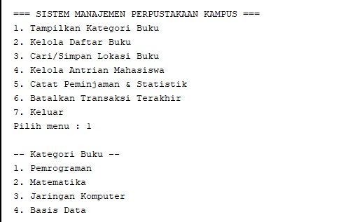

Empat kategori dari array 1D tampil berurutan, nomornya dimulai dari 1.

### Menu 2: kelola daftar buku
Pertama kami menambah buku "belajar java".

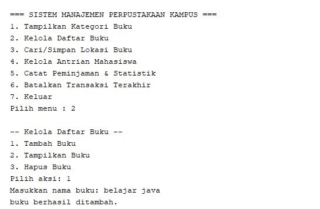

Lalu kami menampilkan isi koleksi, dan yang muncul `[belajar java]`.

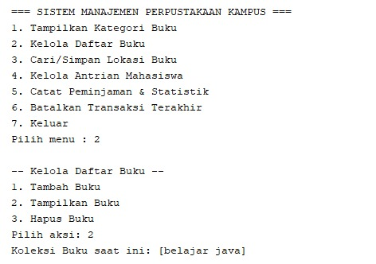

Terakhir kami mencoba menghapus buku "buku java".

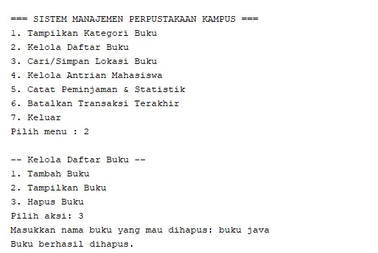

### Menu 3: lokasi buku
Buku "buku PBO" berhasil disimpan di Lantai 1, Rak 2, Posisi 5.

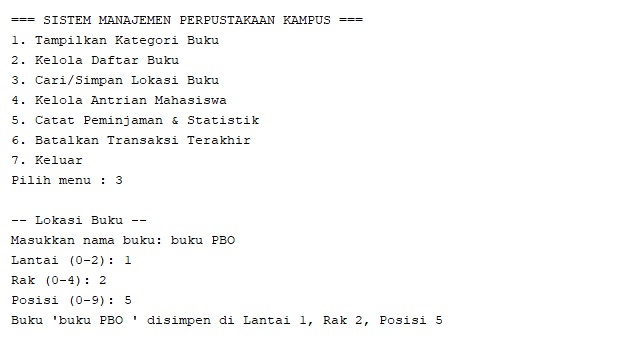

Untuk buku "ddp", kami sengaja mengetik lokasi yang salah tiga kali berturut-turut (lantai 5, lantai 3, lalu lantai 66). Ketiganya ditolak dan program kembali ke menu utama.

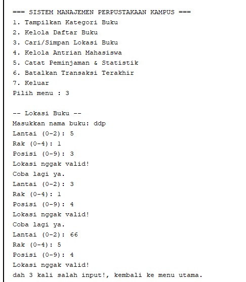

### Menu 4: antrean mahasiswa
Mahasiswa bernama "carla" kami masukkan ke antrean.

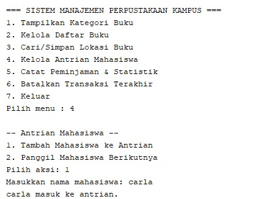

Lalu "carla" dipanggil karena dia yang paling depan.

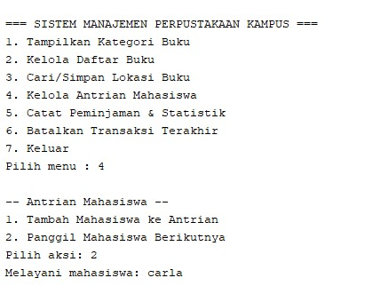

### Menu 5: catat peminjaman dan statistik
"carla" meminjam "jaringan komputer" (kategori 2) pada hari ke-2, dan total peminjaman di sel itu menjadi 1.

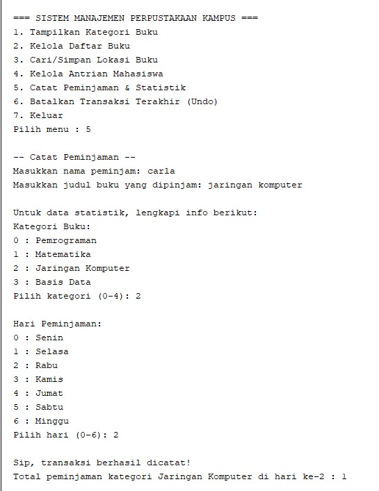

Di percobaan lain, kategori 4 ditolak karena kategori yang ada hanya 0 sampai 3.

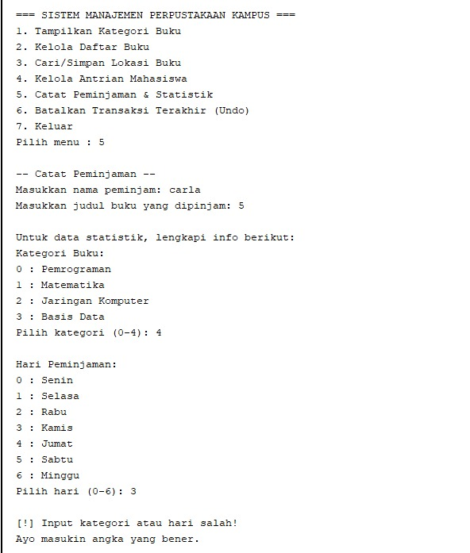

Kalau salah sampai tiga kali (hari 34 dan hari 8 juga ditolak), program kembali ke menu utama.

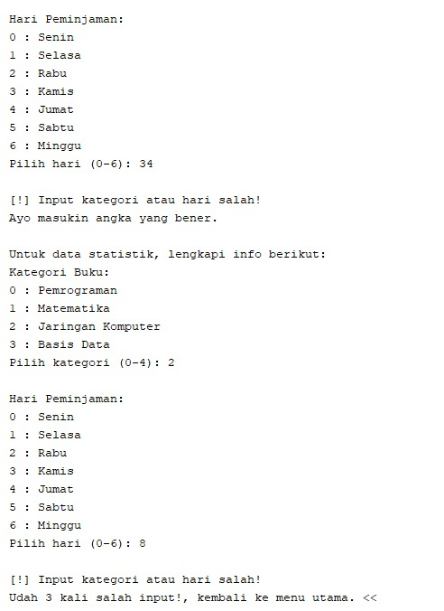

### Menu 6: batalkan transaksi
Transaksi "carla meminjam 'jaringan komputer'" berhasil dibatalkan dengan mengetik nama peminjamnya.

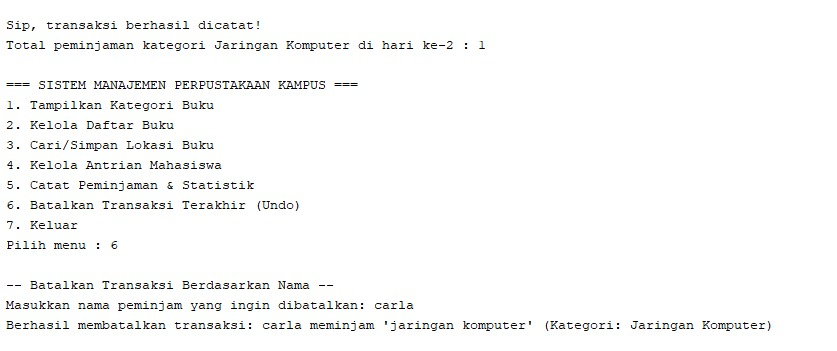

### Menu 7: keluar
Program menampilkan pesan penutup lalu berhenti. Tulisan `BUILD SUCCESS` di bawahnya berasal dari NetBeans.

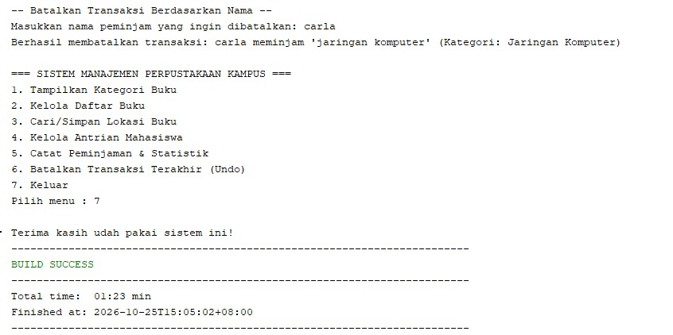

## Hasil Pengujian dan Analisis

### Pengujian
| No | Menu | Skenario | Input | Hasil yang diharapkan | Status |
|----|------|----------|-------|-----------------------|--------|
| 1 | 1 | Lihat kategori | `1` | Empat kategori tampil | Berhasil |
| 2 | 2 | Tambah buku | `2`, `1`, `belajar java` | Judul masuk ke ArrayList | Berhasil |
| 3 | 2 | Tampilkan buku | `2`, `2` | Muncul `[belajar java]` | Berhasil |
| 4 | 2 | Hapus buku | `2`, `3`, `buku java` | Buku dihapus, muncul pesan sukses | Berhasil |
| 5 | 3 | Lokasi valid | `3`, `buku PBO`, `1`, `2`, `5` | Tersimpan di `[1][2][5]` | Berhasil |
| 6 | 3 | Lokasi salah 3 kali | `3`, `ddp`, lalu `5 1 3`, `3 1 4`, `66 5 4` | Tiga pesan tidak valid, kembali ke menu | Berhasil |
| 7 | 4 | Tambah antrean | `4`, `1`, `carla` | Nama masuk antrean | Berhasil |
| 8 | 4 | Panggil antrean | `4`, `2` | Nama paling depan dilayani | Berhasil |
| 9 | 5 | Peminjaman valid | `5`, `carla`, `jaringan komputer`, kategori `2`, hari `2` | Statistik naik, transaksi masuk Stack | Berhasil |
| 10 | 5 | Kategori di luar rentang | `5`, `carla`, kategori `4`, hari `3` | Muncul peringatan input salah | Berhasil |
| 11 | 5 | Salah 3 kali | kategori dan hari di luar rentang | Kembali ke menu setelah 3 kali | Berhasil |
| 12 | 6 | Batalkan transaksi | `6`, `carla` | Transaksi carla keluar dari Stack | Berhasil |
| 13 | 7 | Keluar | `7` | Pesan penutup, program berhenti | Berhasil |

### Analisis
Dari pengujian, semua fitur utama berjalan seperti yang kami rancang, dan tiap struktur data punya operasi yang hasilnya terlihat langsung di layar. Validasi rentang di menu 3 dan menu 5 bekerja, dan batas tiga kali percobaan membuat pengguna tidak terjebak di perulangan input.

Ada juga beberapa kekurangan yang kami temukan, dan lebih baik kami tulis apa adanya:

1. Program memakai `nextInt()`, jadi kalau pengguna mengetik huruf di tempat yang meminta angka, program berhenti dengan `InputMismatchException`. Validasi kami baru memeriksa rentang angka, belum jenis ketikannya.
2. Petunjuk di menu 5 tertulis "Pilih kategori (0-4)", padahal kategori yang sah hanya 0 sampai 3. Ini cuma salah tulis di teks, validasinya sendiri sudah benar (lihat pengujian nomor 10).
3. Pembatalan transaksi hanya menghapus catatan di Stack. Angka di `statPinjam` tidak ikut dikurangi, jadi statistik masih menghitung transaksi yang sudah dibatalkan.
4. Semua data hilang begitu program ditutup, karena belum ada penyimpanan ke file atau database.
5. Menu 3 tidak memeriksa apakah judul buku sudah ada di `daftarBuku`, dan sel lokasi yang sudah terisi akan tertimpa tanpa peringatan.

Kalau dikembangkan lagi, hal-hal di atas yang akan kami perbaiki lebih dulu, misalnya dengan `try-catch` untuk input dan pengurangan statistik saat undo.

## Kesimpulan
Program ini berhasil menyatukan enam struktur data dalam satu aplikasi yang jalan utuh. Beberapa strukturnya saling terhubung, misalnya array 1D dipakai di menu kategori sekaligus menu peminjaman, dan hasil peminjaman masuk ke array 2D dan Stack di saat yang sama.

Dari pengerjaan ini kami melihat sendiri kenapa tiap struktur punya tempatnya. Array 1D, 2D, dan 3D pas untuk data yang ukurannya sudah pasti seperti kategori, statistik mingguan, dan denah rak. ArrayList lebih enak untuk koleksi buku yang jumlahnya naik turun. Queue menjaga antrean tetap adil karena yang datang duluan dilayani duluan, sedangkan Stack membuat transaksi terbaru gampang dijangkau saat perlu dibatalkan.

Kami juga belajar bahwa input pengguna sering tidak sesuai bayangan kami. Karena itu validasi bukan tambahan, melainkan bagian yang harus dipikirkan dari awal.
